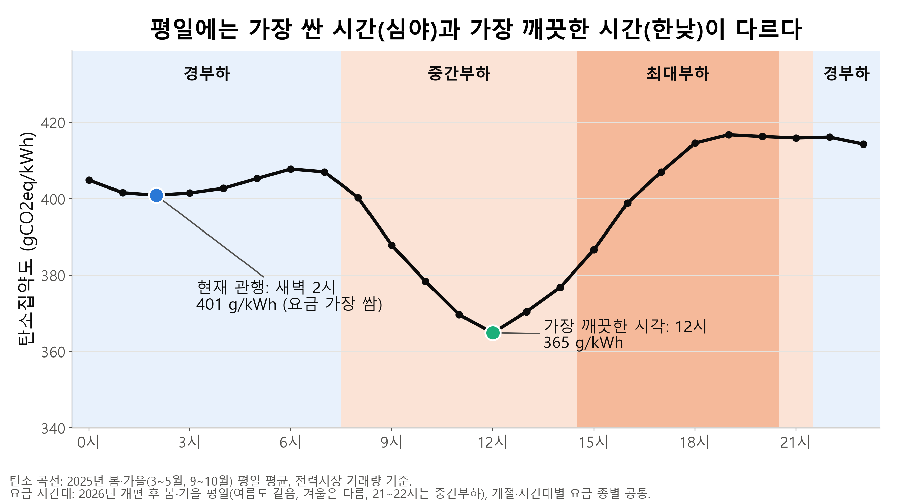

# 서버 작업, 언제 돌려야 탄소가 가장 적을까: 탄소 인지 작업 스케줄링

**급하지 않은 서버 작업(백업, 통계 집계, 모델 학습)을 전기가 깨끗한 시간으로 옮기면 같은 일을 더 적은 탄소로 할 수 있는지, 한국 전력거래소 공개 데이터와 스케줄링 시뮬레이션으로 확인한 프로젝트입니다.** (2026학년도 숭실대학교 ESD 비교과 공모전 출품작)

## 핵심 결과

- 한국 전기는 평일 기준 **한낮(12~13시)에 가장 깨끗하고 저녁에 가장 더럽습니다.** 이 프로젝트가 현재 관행으로 가정한 새벽 2시(심야)는 요금이 가장 싼 시간일 뿐, 가장 깨끗한 시간은 아닙니다.
- 마감을 지키면서 탄소가 적은 시간으로 작업을 옮기는 스케줄러는, 모든 작업을 새벽 2시에 한꺼번에 돌리는 현재 관행보다 **연간 탄소를 9.1% 줄였고 마감은 한 번도 놓치지 않았습니다.** (가상 대학 서버 작업 30개, 2025년 349일 시뮬레이션, 전력시장 거래량 기준)
- 같은 스케줄러라도 주간 작업이 주말까지 기다리지 못하게 하면 절감은 **1.8%**, 기다릴 수 있으면 **9.1%** 입니다. **작업을 얼마나 오래 미룰 수 있느냐가 절감의 크기를 정합니다.**



*2025년 봄·가을 평일 평균 탄소집약도(검은 선)와 요금 시간대(색 띠). 주황 점은 현재 관행인 새벽 2시, 초록 점은 가장 깨끗한 12시.*

## 결과 문서

| 문서 | 내용 |
|---|---|
| [`03_분석/summary_stage1.md`](03_분석/summary_stage1.md) | 한국 전력의 시간별 탄소집약도: 하루 곡선, 계절·평일/주말 차이, 민감도, 한계 |
| [`03_분석/stage2_summary.md`](03_분석/stage2_summary.md) | 스케줄링 시뮬레이션: 정책별 결과, 핵심 발견, 가정 목록, 한계 |
| [`04_발표자료/slides_draft.md`](04_발표자료/slides_draft.md) | 발표 원고(슬라이드별 내용과 대본) |
| [`02_데이터/SOURCES.md`](02_데이터/SOURCES.md) | 사용한 공공데이터의 출처, 받은 날짜, 기간 |
| [`02_데이터/references.md`](02_데이터/references.md) | 배경 통계와 배출계수, 요금제, 참고 문헌의 원문과 출처 |

## 무엇을 했나

1. **데이터 수집:** 공공데이터포털의 전력거래소 연료원별 시간대별 전력거래량(2025년, 비교용 2023년)을 받았습니다.
2. **탄소집약도 계산:** 연료원별 거래량에 IPCC 생애주기 배출계수를 곱해 시간별 탄소집약도(전기 1kWh를 만들 때 나오는 온실가스, gCO2eq/kWh)를 계산했습니다.
3. **스케줄링 시뮬레이션:** 가상의 대학 서버 작업 30개(당일·익일·주간 마감)를 슬롯 2개짜리 서버에서 돌리며 정책을 비교했습니다.
   - 새벽 2시 고정 실행(현재 관행)
   - 탄소만 쫓는 방식
   - 에이징과 마감 가능성 검사를 더한 방식(헤드라인 결과)
   - CPU 주파수 조절(DVFS)을 더한 방식
   - 지난주 값으로 예측하는 방식

자세한 가정과 한계는 결과 문서에 있습니다. 결과는 전력시장 거래량만 쓴 보수적인 값이며, 시장 밖 태양광을 월별 비율로 반영하면 약 13.9%(가정)입니다.

## 저장소에 있는 것과 없는 것

| 폴더 | 내용 | 저장소 |
|---|---|---|
| `scripts/` | 데이터 다운로드부터 발표 자료까지 모든 실행 스크립트 | 있음 |
| `02_데이터/` | 데이터 출처(`SOURCES.md`), 참고 문헌(`references.md`), 원본 점검 결과 | 있음 |
| `02_데이터/raw/` | 공공데이터포털 원본 파일 | **없음** (스크립트로 다시 받음) |
| `03_분석/` | 분석 결과 표(CSV), 그래프, 요약 문서 | 있음 |
| `04_발표자료/` | 발표 원고, 발표용 그림 | 있음 |
| `04_발표자료/*.pptx, *.pdf` | 제출용 발표 자료 | **없음** (스크립트로 다시 만듦) |
| `01_공고_신청서/`, `05_영상/`, `99_제출/` | 공모전 서류, 발표 영상, 제출 파일 | **없음** |

## 다시 실행하기

Python 3.11 이상. 프로젝트 폴더에서 아래 순서대로 실행하면 데이터를 다시 받고 모든 표와 그래프를 다시 만듭니다. 로그인이나 인증키는 필요 없습니다.

```bash
pip install -r requirements.txt
python scripts/00_download_data.py     # 공공데이터포털·EPSIS 원본 다운로드 -> 02_데이터/raw/
python scripts/01_profile_raw.py       # 원본 점검(인코딩, 컬럼, 기간, 연료원) -> 02_데이터/raw_profile.md
python scripts/02_carbon_intensity.py  # 시간별 탄소집약도, 변동폭, 민감도, 그래프 -> 03_분석/
python scripts/03_stage1_report.py     # 1단계 요약 -> 03_분석/summary_stage1.md
python scripts/04_simulate.py          # 스케줄링 시뮬레이션 -> 03_분석/stage2/
python scripts/05_stage2_report.py     # 2단계 요약 -> 03_분석/stage2_summary.md
python scripts/06_presentation_figures.py  # 발표용 그래프 모으기 -> 04_발표자료/figures/
python scripts/07_slide_figures.py     # 슬라이드 전용 그림(16:9) -> 04_발표자료/figures/
```

발표 자료(PPTX, PDF)는 Windows와 Microsoft PowerPoint, Pretendard 글꼴이 있어야 만들 수 있습니다.

```bash
python scripts/08_build_deck.py        # python-pptx로 초안 -> 04_발표자료/_build/deck_raw.pptx
powershell -ExecutionPolicy Bypass -File scripts/09_export_deck.ps1   # 글꼴 포함 PPTX + PDF
```

표지의 소속·학번·이름은 `04_발표자료/author.local.txt`(저장소에 넣지 않음) 한 줄에서 읽고, 파일이 없으면 이름만 넣습니다. 발표 대본은 `04_발표자료/slides_draft.md`에서 읽어 발표자 노트에 넣습니다.

### 주요 설정 파일

- `scripts/config_emission_factors.py`: 연료원별 배출계수와 출처
- `scripts/config_simulation.py`: 작업 세트, 서버 슬롯 수, DVFS, 에이징 등 시뮬레이션 가정
- `scripts/common.py`: 경로, 분석 연도, 탄소 곡선 선택(`CURVES`), 그래프 색

## 데이터를 직접 받아야 할 때

`00_download_data.py`는 공공데이터포털 웹페이지의 [다운로드] 버튼과 같은 절차를 따릅니다. 포털이 다운로드 횟수 제한으로 보안문자(캡차)를 요구하거나 페이지 구조가 바뀌면 "[수동 다운로드 필요]"를 출력하고 멈춥니다. 이때는 아래 페이지에서 직접 받아 `02_데이터/raw/`에 **파일명을 바꾸지 말고** 넣은 뒤 다음 스크립트부터 실행합니다. 원본 CSV는 모두 cp949 인코딩입니다.

| 데이터셋 | 페이지 | 받을 파일 |
|---|---|---|
| 한국전력거래소_연료원별 시간대별 설비용량 및 전력거래량 | https://www.data.go.kr/data/15127395/fileData.do | 기본 파일(2025년판) + "주기성 과거 데이터"의 20241231, 20231231판 (각 팝업의 CSV 버튼) |
| 한국전력거래소_연료원별 전력거래량 | https://www.data.go.kr/data/15081098/fileData.do | 기본 파일 |
| 한국전력거래소_지역별 시간별 태양광 및 풍력 발전량 | https://www.data.go.kr/data/15065269/fileData.do | 기본 파일 |
| 한국전력거래소_시간별 전국 전력수요량 | https://www.data.go.kr/data/15065266/fileData.do | 기본 파일 |
| EPSIS 추계정보(태양광 월별) | https://epsis.kpx.or.kr/epsisnew/selectEkgeEpsEstGrid.do?menuId=030400 | 페이지를 HTML로 저장해 `EPSIS_태양광발전량추계_월별_030400.html` 이름으로 |

### 참고: 쓰지 못한 자료(전력거래소 5분 단위 태양광)

전력거래소 홈페이지의 [발전원별 실시간 전력수급현황](https://www.kpx.or.kr/powerSource.es?mid=a10606030000&device=chart)에는 시장 밖 태양광(PPA·자가용) 추정치가 5분 단위로 있습니다. 하지만 2026-11-06 기준 엑셀 다운로드가 막혀 있어(스크립트는 웹 방화벽 차단, 브라우저에서도 HTTP 503) 이번 분석에는 쓰지 않았습니다. **현재 결과를 재현하는 데는 필요 없습니다.** 나중에 받을 수 있게 되면 한 달씩 받아 `02_데이터/raw/kpx_solar_5min/2025-01.xlsx` ~ `2025-12.xlsx`로 넣으면 됩니다. 이 경우 `00_download_data.py`가 12개 파일이 다 있는지 확인해 줍니다. 자세한 상태는 `02_데이터/SOURCES.md` 6절에 있습니다.
